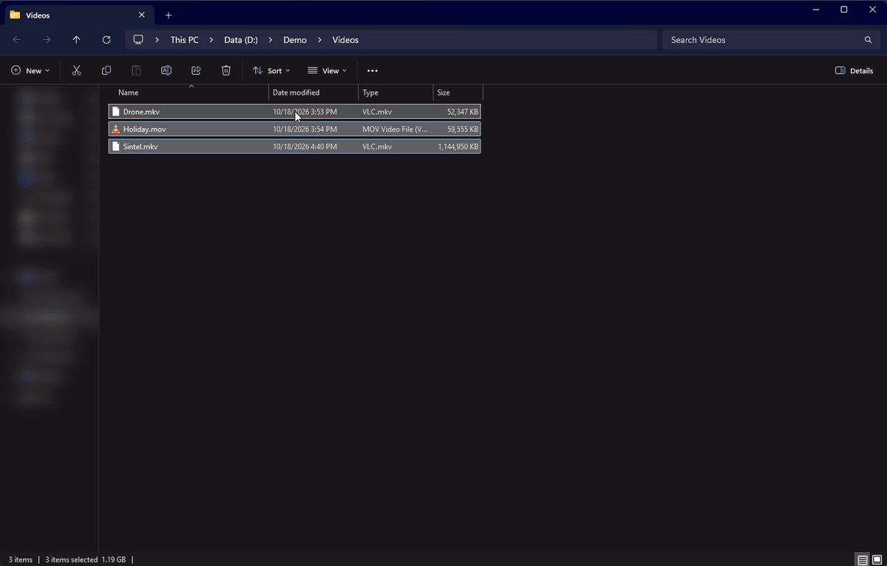

# File Converter

## Description

**File Converter** is a very simple tool which allows you to convert and compress one or several file(s) using the context menu of windows explorer.

You can download it here: [file-converter.io](https://file-converter.io/?from=readme.md).

You can find more information about what's in File converter and how to use it on the [wiki](https://github.com/Tichau/FileConverter/wiki).

## About this fork (fast-convert)

This fork of [Tichau/FileConverter](https://github.com/Tichau/FileConverter) makes conversions faster without changing how File Converter is used. Every optimization falls back automatically to the original behavior when it can't be used, and existing settings files keep working.

- **Hardware video encoding** (NVIDIA NVENC, AMD AMF, Intel Quick Sync), detected with a test encode and used by default, with the CPU encoder as fallback. Quality settings are calibrated to give the same quality as the CPU encoders. [docs/HARDWARE-ENCODING.md](docs/HARDWARE-ENCODING.md)
- **Stream copy**: a conversion that only changes the container (mkv to mp4, mov to mp4...) copies the streams instead of re-encoding them. [docs/REMUXING.md](docs/REMUXING.md)
- **libvips** for JPEG, PNG, WebP, TIFF and AVIF images, ImageMagick for everything else. [docs/IMAGES.md](docs/IMAGES.md)
- **Parallel scheduling**: one conversion per CPU core, with separate limits for GPU encodes, CPU video encodes and Office documents. [docs/SCHEDULING.md](docs/SCHEDULING.md)
- **Settings > Performance** tab and per-file diagnostics (conversion path and duration). [docs/SETTINGS.md](docs/SETTINGS.md)

Measured on a Ryzen 9 7950X3D with an RTX 5070 Ti, against the original at its default settings ([bench/REPORT.md](bench/REPORT.md)):

| Conversion | Original | This fork |
|---|---:|---:|
| Sintel 1080p, 15 min MKV → To Mp4 | 81.5 s | 2.3 s (stream copy) |
| H.264 4K 30 s → To Mp4 | 20.2 s | 7.1 s (NVENC) |
| 200 × 24 MP JPEG → Scale 25%/To Webp | 55.8 s | 3.6 s |
| 10 × 24 MP WebP → To Png | 22.4 s | 4.9 s |
| 20 × 24 MP JPEG → To Avif | 24.9 s | 10.7 s |

Audio conversions and RAW / HEIC images are unchanged; extracting the audio of a video file takes about 0.3 s more (the file is probed to see whether its audio can be copied). The original also hangs on long video conversions (ffmpeg blocked on its progress output); this is fixed here.

Tests: unit tests in `Tests/FileConverter.Tests` (xUnit, in the solution) and integration tests on a test corpus (`Tests/integration.ps1`), see [Tests/README.md](Tests/README.md). Benchmarks: [bench/README.md](bench/README.md).

## Donate

File Converter is a personal open source project started in 2014. I have put hundreds of hours adding, refining and tuning File Converter with the goal of making the conversion and compression of files an easy task for everyone.

You can help me by [contributing to the project](https://github.com/Tichau/FileConverter/wiki#contribute), by [making a donation](https://www.paypal.com/donate/?cmd=_donations&business=3BDWQTYTTA3D8&item_name=File+Converter+Donations&currency_code=EUR&Z3JncnB0=) or just by [saying thanks](https://saythanks.io/to/Tichau) :).

## Troubleshooting

If you encounter any problem with File Converter, you can:

* See the already known problems in the [troubleshooting section of the documentation](https://github.com/Tichau/FileConverter/wiki/Troubleshooting).
* Or report an issue on the [bug tracker](https://github.com/Tichau/FileConverter/issues).

## Setup development environment

### Requirements

For File Converter and its explorer extension:

* Visual Studio 2022

For the installer:

* [Wix 5](http://wixtoolset.org/) (will be installed by nuget)
  * [Community Visual Studio Extension](https://marketplace.visualstudio.com/items?itemName=FireGiant.FireGiantHeatWaveDev17)
* [Windows SDK Signing Tools for Desktop Apps](https://developer.microsoft.com/fr-fr/windows/downloads/windows-10-sdk)

## Thanks

Thanks to all the contributors of File Converter project.

### Localization

* Thanks to **Khidreal** and **hugok79** for the Portuguese localization.
* Thanks to **Marhc** for the Brazilian localization.
* Thanks to **Chachak** for the Spanish localization.
* Thanks to **Davide** for the Italian localization.
* Thanks to **nikotschierske** for the German localization.
* Thanks to **Snoopy1866** for the Simplified Chinese localization.
* Thanks to **MayaC0re** for the Turkish localization.
* Thanks to **vishveshjain** for the Hindi localization.
* Thanks to **Mahmoud0Sultan** for the Arabic localization.
* Thanks to **Sedimentary-Rock**, **NeKoOuO** and **PeterDaveHello** for the Traditional Chinese localization.
* Thanks to **CrisBalGreece** for the Greek localization.
* Thanks to **AshiVered** for the Hebrew localization.
* Thanks to **MrHero118** and **Mehrdad32** for the Persian localization.
* Thanks to **crnobog69** for the Serbian localizations.
* Thanks to **oogamiyuta** for the Japanese localization.
* Thanks to **AidyTheWeird** for the Czech localization.
* Thanks to **Alanimdeo** for the Korean localization.
* Thanks to **vrykolakas166** and **thaovd** for the Vietnamese localization.
* Thanks to **iliamak** for the Russian localization.
* Thanks to **itsmefdil** for the Indonesian localization.
* Thanks to **hamzaharoon1314** for the Urdu localization.
* Thanks to **Zyvrec7** and **stohlferenc** for the Hungarian localization.
* Thanks to **Maerek** and **MrPrince419** for the Polish localization.
* Thanks to **rkalitta** for the Swedish localization.

## Middlewares

File converter uses the following middlewares:

**ffmpeg** and **ffprobe** (v8.0.1) as file conversion and media analysis software.
Thanks to ffmpeg devs for this awesome open source file conversion tool. [Web site link](https://ffmpeg.org)

**ImageMagick** (v14.10) as image edition and conversion software.
Thanks to image magick devs for this awesome open source image edition software suite.  [Web site link](http://imagemagick.net)
And thanks to dlemstra for the C# wrapper of this software. [Github link](https://github.com/ImageMagick/ImageMagick)

**libvips** (v8.18.7, LGPL-2.1-or-later) as fast image conversion library for JPEG, PNG, WebP, TIFF and AVIF.
Thanks to John Cupitt, Kleis Auke Wolthuizen and the libvips contributors. [Web site link](https://www.libvips.org)
And thanks to Kleis Auke Wolthuizen for **NetVips** (v3.2.0, MIT), the C# binding of libvips. [GitHub link](https://github.com/kleisauke/net-vips)

**Ghostscript** (10.02.1) as pdf edition software.
Thanks to ghostscript devs. [Download link](https://www.ghostscript.com/download/gsdnld.html)

**SharpShell** to easily create windows context menu extensions.
Thanks to Dave Kerr for his work on SharpShell. [GitHub link](https://github.com/dwmkerr/sharpshell)

**Ripper** and **yeti.mmedia** for CD Audio extraction.
Thanks to Idael Cardoso for his work on CD Audio ripper. [Code project link](https://www.codeproject.com/Articles/5458/C-Sharp-Ripper)

**Markdown.XAML** for markdown rendering in the wpf application.
Thanks to Bevan Arps for his work on Markdown.XAML. [GitHub link](https://github.com/theunrepentantgeek/Markdown.XAML)

**WpfAnimatedGif** for animated gif rendering in the wpf application.
Thanks to Thomas Levesque for his work on WpfAnimatedGif. [GitHub link](https://github.com/XamlAnimatedGif/WpfAnimatedGif)

## License

File Converter is licensed under the GPL version 3 License.
For more information check the LICENSE.md file in your installation folder or the [gnu website](https://www.gnu.org/licenses/gpl.html).

ffmpeg and ffprobe are the GPLv3 "essentials" build of [gyan.dev](https://www.gyan.dev/ffmpeg/builds/); their license and the location of their source are installed as `ffmpeg-LICENSE.txt` and `ffmpeg-README.md` (`Middleware/ffmpeg`).

libvips is distributed under the LGPL-2.1-or-later as unmodified DLLs in the `libvips` folder of the installation, with its license, its source and the versions of every library (`Middleware/libvips`); it is loaded dynamically and can be replaced by another build of the same version. NetVips is under the MIT license.
