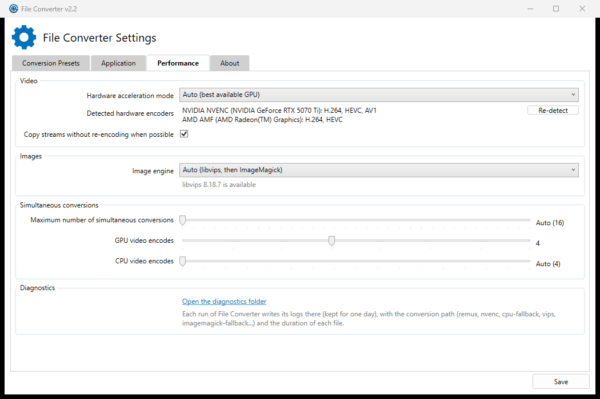

# Performance settings and diagnostics (Phase 5)



## Settings → Performance

The settings added by Phases 1 to 4 were in the Application tab, or had no UI. They are now grouped in a Performance
tab (`Views/SettingsWindow.xaml`); the Application tab keeps language, exit, update and clipboard options.

| Group | Setting | Default | Details |
|---|---|---|---|
| Video | Hardware acceleration mode (`HardwareAccelerationMode`) | Auto | `docs/HARDWARE-ENCODING.md` |
| Video | Detected hardware encoders | — | One line per vendor, in priority order, with the GPU names and codecs, e.g. `NVIDIA NVENC (NVIDIA GeForce RTX 5070 Ti): H.264, HEVC, AV1` / `AMD AMF (AMD Radeon(TM) Graphics): H.264, HEVC`. "None: videos are encoded by the CPU" when no test encode succeeds. |
| Video | Re-detect | — | Runs the test encodes again (`IHardwareEncoderDetector.Redetect`) and rewrites `hw-cache.json`, so the next conversions use the new result. Runs in the background; the button is disabled and the list shows "Detecting..." meanwhile. |
| Video | Copy streams without re-encoding when possible (`CopyStreamsWhenPossible`) | on | `docs/REMUXING.md` |
| Images | Image engine (`ImageEngine`) | Auto | `docs/IMAGES.md`. Below it: "libvips 8.18.7 is available", or why libvips can't be loaded (then ImageMagick converts every image). |
| Simultaneous conversions | Maximum number of simultaneous conversions (`MaximumNumberOfSimultaneousConversions`) | Auto (one per physical core) | `docs/SCHEDULING.md` |
| Simultaneous conversions | GPU video encodes (`MaximumNumberOfSimultaneousGpuConversions`) | 4 | 1 to 8. GPU lane limit and GPU session limiter. |
| Simultaneous conversions | CPU video encodes (`MaximumNumberOfSimultaneousCpuVideoConversions`, new) | Auto (physical cores / 4, within 2..4) | 0 = Auto, up to the number of physical cores. A missing element means Auto: no migration. |
| Diagnostics | Open the diagnostics folder | — | Opens `%LOCALAPPDATA%\FileConverter`, which holds a `Diagnostics-<time>` folder per run (kept one day). |

The GPU names come from WMI (`Win32_VideoController`), matched to the encoder vendor by PCI vendor id (NVIDIA 10DE,
AMD 1002, Intel 8086): `Hardware/HardwareEncoderSummary.cs`. The detection itself is unchanged: an encoder is listed
only if its test encode succeeded, so a GPU without AV1 (the Radeon iGPU above) doesn't list it.

Strings are in English and French (`Properties/Resources.resx`, `Resources.fr-FR.resx`); other languages fall back to
English. The French file also gets the hardware acceleration mode strings, which it was missing since upstream.

## Diagnostics

Each job ends its log with the path that converted it and how long it took, and the queue thread logs a summary:

```
Job done: path vips, 0.17 s (Light, 10 threads): ...\img_002.jpg
Job done: path imagemagick, 2.07 s (Light, 10 threads): ...\canon_5d3.CR2
Job done: path amf-cpu-decode, 6.50 s (Gpu, 16 threads): ...\h264_422_10bit.mkv
Conversions finished in 9.43 s: 2 done, 0 failed, paths: amf-cpu-decode x2.
```

The duration runs from the start of the conversion (after preparation) to the end, fallbacks included. The thread
count is the job's budget (`docs/SCHEDULING.md`); hardware encodes don't use it.

| Path | Meaning |
|---|---|
| `remux` | Streams copied without re-encoding (`docs/REMUXING.md`) |
| `nvenc` | NVDEC + CUDA filters + NVENC |
| `nvenc-cpu-filters` | NVENC with CPU filters (rotation, pixel formats the CUDA pipeline doesn't take) |
| `amf`, `qsv` | Hardware decode + AMF / Quick Sync encode |
| `amf-cpu-decode`, `qsv-cpu-decode` | CPU decode + AMF / Quick Sync encode |
| `cpu` | Software encode (hardware acceleration Off, or no hardware encoder for the codec) |
| `cpu-fallback` | Software encode after the hardware attempts failed |
| `ffmpeg` | Single-path ffmpeg jobs (audio, custom presets) |
| `vips` | Image converted by libvips |
| `imagemagick` | Image converted by ImageMagick because libvips doesn't handle it (format, setting) |
| `imagemagick-fallback` | Image converted by ImageMagick after libvips failed |
| `word`, `excel`, `powerpoint`, `extractcda`, `ico`, `gif` | Other job types (one path each) |

A failed job reports the last path it tried. Each fallback is also logged when it happens
(`Encoding path 'amf' failed (...). Falling back to 'amf-cpu-decode'.`, `Image engine: imagemagick-fallback (...)`).
`bench/try-case.ps1` prints these lines.
